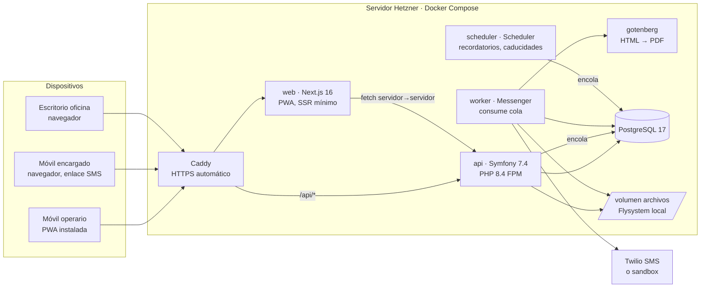

# FLEETCORE — Arquitectura técnica y plan de entregas

**Fecha:** 21 de noviembre de 2026
**Fase del plan:** 14 (Arquitectura) de la sección 22 del documento maestro
**Depende de:** `decisiones-descubrimiento-03-tecnicas.md`, `modelo-datos-01-entidad-relacion.md`, formularios 01 a 07
**Estado:** Definitivo para la primera versión

---

## 1. Vista general



Un solo servidor, siete contenedores, una base de datos. No hay Redis, ni colas externas, ni almacenamiento de objetos en la primera versión. Cada pieza se puede sustituir después sin tocar el dominio.

---

## 2. Repositorio: monorepo

```
fleetcore/
├── apps/
│   ├── api/                 Symfony 7.4
│   └── web/                 Next.js 16
├── infra/
│   ├── caddy/Caddyfile.dev          desarrollo
│   ├── caddy/Caddyfile.prod         producción, HTTPS automático
│   └── scripts/                     copias de seguridad, despliegue
├── docs/                    los documentos de descubrimiento y diseño
│   ├── adr/                 decisiones de arquitectura numeradas
│   ├── glosario.md
│   └── referencia/
├── .github/workflows/       CI
├── compose.yaml             stack de desarrollo
├── compose.prod.yaml        stack de producción (imágenes publicadas)
├── Makefile · dev.sh        comandos de desarrollo (dev.sh para Windows sin make)
├── README.md                bilingüe, con capturas y demo
├── CONTRIBUTING.md          convenciones de código y commits
└── CHANGELOG.md             una entrada por hito
```

Un solo repositorio porque una sola persona lo mantiene y porque el recruiter ve el proyecto completo de una vez. `docs/adr/` recogerá las decisiones técnicas en formato ADR (contexto, decisión, consecuencias), empezando por las del registro nº 3.

---

## 3. Backend: Symfony como monolito modular

### 3.1. Organización del código

Por **módulos de dominio**, no por tipo técnico. Cada módulo contiene sus entidades, repositorios, DTO, servicios, voters y controladores.

```
apps/api/src/
├── Shared/              Kernel, excepciones comunes, utilidades, auditoría, archivos, SMS
├── Identity/            User, roles, tokens, activación, recuperación
├── Company/             CompanySettings
├── Client/              Client, ClientContact
├── WorkSite/            WorkSite, foremen, planned resources, Route
├── Fleet/               Supplier, Machine, Truck, TransportEquipment, categorías, VehiclePlate
├── Implement/           ImplementType, Implement, relación con categorías
├── Report/              Report, líneas, secuencia, snapshot, hash, PDF
├── Signing/             SigningLink, Signature, SignedReport, verificación pública
└── Notification/        SmsMessage, UserNotification, recordatorios
```

Dentro de cada módulo:

```
Report/
├── Domain/              Entidades Doctrine, enums, excepciones de dominio, eventos
├── Application/         Casos de uso (servicios), DTO de entrada y salida, mensajes de Messenger
├── Infrastructure/      Repositorios Doctrine, adaptadores (Gotenberg, Flysystem)
└── Presentation/        Controladores HTTP, voters, transformadores a JSON
```

Es la estructura que un recruiter Symfony reconoce. Es más capas de las que Laravel acostumbra; se compensa con que cada archivo hace una sola cosa.

### 3.2. Flujo de una petición

1. Caddy recibe `POST /api/reports/{id}/send` y lo pasa a PHP-FPM.
2. El `AccessTokenHandler` busca el hash del token en `access_token`, comprueba caducidad y revocado, carga el usuario y extiende la caducidad.
3. El controlador recibe un DTO hidratado y validado con `#[MapRequestPayload]`. Si falla la validación, Symfony devuelve 422 con los errores por campo.
4. `ReportVoter` decide si ese usuario puede `SEND` ese albarán.
5. El caso de uso `SendReport` ejecuta en una transacción: validaciones de negocio, número de secuencia con bloqueo, snapshot, hash, cambio de estado, evento de dominio.
6. Un subscriber del evento escribe en `audit_log` y encola `GenerateProvisionalPdf` y `NotifyForeman`.
7. El controlador devuelve 200 con el albarán serializado.
8. El worker procesa los mensajes: llama a Gotenberg, guarda el PDF con Flysystem, envía el SMS por Twilio o lo guarda en sandbox.

### 3.3. Reglas de implementación

- **Entidades sin lógica de aplicación.** Métodos que cambian estado (`send()`, `markSigned()`) viven en la entidad y lanzan excepciones de dominio si la transición no es válida. La orquestación vive en los casos de uso.
- **Un caso de uso por acción**, con un método `__invoke` o `execute`. Nombres en verbo: `CreateClient`, `OpenWorkSite`, `SendReport`, `SignReports`.
- **DTO de entrada y salida separados** de las entidades. Nunca se serializa una entidad directamente.
- **Voters por entidad** con constantes de acción. Toda ruta protegida llama a `denyAccessUnlessGranted`.
- **Validación en tres capas**: atributos de Validator en DTO (formato), reglas de negocio en casos de uso (estado, relaciones), restricciones en PostgreSQL (última defensa).
- **Auditoría automática** mediante un listener de Doctrine para cambios en entidades maestras, más registros explícitos en casos de uso de negocio (enviar, firmar, anular).
- **Excepciones de dominio** mapeadas a códigos HTTP por un listener: `InvalidTransition` → 409, `NotFound` → 404, `Forbidden` → 403, validación → 422.
- **Sin SQL en cadenas**. Repositorios con QueryBuilder o DQL con parámetros. SQL nativo solo para la secuencia con `FOR UPDATE` y para la verificación de triggers, en archivos de migración revisados.

### 3.4. Paquetes previstos

| Necesidad | Paquete |
|---|---|
| ORM y migraciones | `doctrine/orm`, `doctrine/doctrine-migrations-bundle` |
| UUID v7 | `symfony/uid` |
| Validación, serialización | `symfony/validator`, `symfony/serializer`, `symfony/property-access` |
| Seguridad | `symfony/security-bundle`, `symfony/rate-limiter` |
| Colas y tareas | `symfony/messenger`, `symfony/scheduler` |
| Archivos | `league/flysystem-bundle` |
| PDF | `gotenberg/gotenberg-php` |
| SMS | `twilio/sdk` detrás de `SmsSenderInterface` |
| Plantillas PDF | `symfony/twig-bundle` solo para la plantilla del albarán |
| Fixtures | `doctrine/doctrine-fixtures-bundle`, `zenstruck/foundry` |
| Pruebas | `phpunit/phpunit`, `symfony/browser-kit`, `dama/doctrine-test-bundle` |
| Calidad | `phpstan/phpstan` nivel 8, `friendsofphp/php-cs-fixer`, `rector/rector` |

No se incluye API Platform ni ningún bundle de administración. Ver registro nº 3, punto 5.

---

## 4. Frontend: Next.js como PWA

### 4.1. Organización

```
apps/web/src/
├── app/
│   ├── (office)/            rutas de oficina y consulta: escritorio
│   ├── (operator)/          rutas de operario: móvil
│   ├── f/[token]/           firma remota del encargado, sin sesión
│   ├── v/[id]/              verificación pública
│   └── api/                 solo proxy de sesión si hiciera falta
├── features/                un directorio por módulo: clients, work-sites, fleet, reports, signing
│   └── reports/
│       ├── api.ts           funciones fetch tipadas
│       ├── schemas.ts       Zod, espejo de los DTO del backend
│       ├── components/
│       └── hooks/
├── shared/                  UI base, cliente HTTP, autenticación, utilidades
└── offline/                 IndexedDB (Dexie), cola de sincronización, service worker
```

### 4.2. Decisiones

- **Tres superficies con diseño distinto**: oficina en escritorio con tablas y formularios densos; operario en móvil con tarjetas y botones grandes; encargado en móvil con el mínimo absoluto. Comparten componentes base pero no plantillas.
- **Renderizado**: oficina y operario son aplicaciones cliente tras autenticación; no necesitan SEO. Firma y verificación se renderizan en servidor para abrirse rápido desde un SMS.
- **Estado de servidor** con TanStack Query. Sin gestor de estado global.
- **Validación** con Zod, con esquemas que replican los DTO del backend. Los mensajes de error se escriben en lenguaje de obra, no técnico.
- **PWA**: manifiesto, instalable, service worker con Serwist. Caché de la aplicación y de los catálogos (obras abiertas, recursos activos, implementos, recorridos) para poder crear albaranes sin red.
- **Borradores sin cobertura**: se guardan en IndexedDB a cada cambio. Una cola de sincronización envía al recuperar red. El número de albarán llega del servidor; mientras tanto se muestra "Pendiente de enviar".
- **Cámara y GPS** por las API del navegador. Las fotos se reducen en el cliente antes de subir.
- **Firma manuscrita** con un lienzo propio, exportado a PNG. Se valida el trazo mínimo en cliente y en servidor.

### 4.3. Comunicación con la API

- Token en cabecera `Authorization: Bearer`. Guardado en almacenamiento local cifrado del navegador para la PWA; en cookie `HttpOnly` para oficina en escritorio mediante un proxy mínimo en Next.js. Dos mecanismos porque las amenazas son distintas: en el móvil instalado el riesgo es perder el dispositivo (se resuelve con cierre remoto); en el escritorio es XSS (se resuelve con cookie).
- Errores 422 se mapean campo a campo a los formularios. Errores 409 se muestran como aviso de conflicto con opción de recargar.
- Tipos TypeScript de la API generados desde una especificación OpenAPI que el backend publica con `nelmio/api-doc-bundle`. Evita desincronización entre DTO y esquemas Zod.

---

## 5. Seguridad: consolidación

Resumen de lo definido en los formularios, para tenerlo en un sitio.

| Amenaza | Defensa |
|---|---|
| Acceso a albaranes ajenos | Voters sobre cada recurso; auditoría de denegaciones |
| Robo de token | Hash en base de datos, revocación, límite de dispositivos, caducidad |
| Fuerza bruta en acceso y códigos | Rate limiter por teléfono e IP; bloqueo progresivo; códigos de 6 dígitos con 5 intentos |
| Enumeración de usuarios | Respuestas idénticas en recuperación exista o no el teléfono |
| Inyección SQL | Doctrine con parámetros; SQL nativo solo en migraciones |
| XSS | Escape de React; sin `dangerouslySetInnerHTML`; cabecera CSP estricta desde Caddy |
| CSRF | API sin cookies para móvil; para escritorio, cookie `SameSite=Strict` más cabecera personalizada |
| Archivos maliciosos | MIME por contenido, extensión controlada, nombre aleatorio, volumen sin ejecución, servicio por endpoint autorizado |
| Alteración de documentos firmados | Snapshot, hash, PDF inmutable, triggers de solo inserción, verificación pública |
| Suplantación del encargado | Código a móvil registrado; registro de IP, dispositivo y hora; rúbrica |
| Pérdida de datos | Copia diaria de PostgreSQL y del volumen de archivos a almacenamiento externo cifrado, retención 30 días, restauración probada una vez al mes |
| Secretos | Variables de entorno en el servidor, nunca en el repositorio; `symfony secrets` para producción |

---

## 6. Entornos y despliegue

| Entorno | Dónde | Datos | Para qué |
|---|---|---|---|
| Local | Docker Compose en el portátil | Fixtures | Desarrollo diario |
| CI | GitHub Actions | Base de datos efímera | Pruebas en cada push y pull request |
| Demo | Hetzner, `fleetcore.larryyoffre.com` | Fixtures realistas, reinicio semanal, SMS en sandbox | Portfolio y pruebas con la empresa |
| Producción | Hetzner, dominio de la empresa | Reales, copias diarias, SMS reales | Cuando la empresa lo adopte |

Despliegue: GitHub Actions construye las imágenes, las publica en GitHub Container Registry y un script por SSH hace `docker compose pull && up -d` y ejecuta migraciones. Sin herramientas adicionales.

Observabilidad mínima: logs en JSON a stdout recogidos por Docker, Sentry gratuito para errores de backend y frontend, y un chequeo externo gratuito de disponibilidad.

---

## 7. Pruebas

| Nivel | Herramienta | Qué cubre | Objetivo |
|---|---|---|---|
| Unitarias backend | PHPUnit | Entidades (transiciones de estado), servicios de dominio (hash, snapshot, numeración), validadores propios (NIF) | Toda regla de negocio escrita en los formularios tiene una prueba |
| Integración backend | PHPUnit + `WebTestCase` + base de datos real | Cada endpoint: casos válido, inválido, sin permiso | Un test por fila de la matriz de permisos |
| Unitarias frontend | Vitest + Testing Library | Esquemas Zod, componentes de formulario, lógica offline | Lo que tiene lógica, no el aspecto |
| Recorridos completos | Playwright | Los tres flujos de la sección 16 del maestro: oficina prepara, operario crea y envía, encargado firma | Tres recorridos verdes en CI antes de cada despliegue |
| Estático | PHPStan nivel 8, ESLint, TypeScript estricto | Todo el código | Sin errores en CI |

---

## 8. Plan de entregas

El tiempo disponible no es fijo, así que el plan se organiza por **hitos cerrados**, no por fechas. Cada hito termina con algo que se puede enseñar y desplegar. El orden sigue la cadena del producto: oficina → operario → encargado.

| Hito | Contenido | Qué se puede enseñar al terminar |
|---|---|---|
| **H0 Cimientos** | Monorepo, Docker Compose, Symfony y Next.js vacíos conectados, PostgreSQL, CI con pruebas de humo, despliegue en demo, README inicial, ADR 001 a 005 | Un repositorio profesional con CI verde y una URL que responde |
| **H1 Identidad** | User, roles, tokens, activación por SMS sandbox, recuperación, bloqueo, voters base, pantalla de acceso | Acceso real con roles. Primera matriz de permisos probada |
| **H2 Clientes y obras** | Client, ClientContact, WorkSite con estados, foremen, Route. Formularios de oficina. Validación de NIF | Oficina funcional para preparar una obra completa |
| **H3 Flota** | Supplier, categorías, Machine, TruckType, Truck, TransportEquipment, VehiclePlate, Attachment con fotos y documentos, implementos | Oficina completa. Panel de caducidades |
| **H4 Albarán** | Report con líneas, secuencia, snapshot, hash, estados, pantallas de operario, "repetir el de ayer" | **El flujo central funciona**: un operario crea y envía un albarán desde el móvil |
| **H5 Firma presencial y PDF** | Signature presencial, rúbrica, Gotenberg, PDF calcado al papel, verificación pública | Un albarán firmado con PDF descargable y verificable. Primera demo completa para la empresa |
| **H6 Firma remota** | SigningLink, códigos, pantalla del encargado, lote, rechazo con versión 2, recordatorios con Scheduler, panel de pendientes, sandbox de SMS visible | El flujo completo de los tres roles, de principio a fin |
| **H7 Oficina avanzada** | Edición de pendientes con auditoría, anulación y rectificativo, firma en papel registrada, recorridos provisionales, conflictos de equipo, auditoría navegable | Trazabilidad completa. Lo que distingue un producto de un prototipo |
| **H8 Sin cobertura** | PWA instalable, caché de catálogos, borradores en IndexedDB, cola de sincronización | El operario trabaja en un tajo sin señal |
| **H9 Presentación** | Fixtures realistas, cuentas de demo, capturas, README bilingüe definitivo, caso de estudio en larryyoffre.com, vídeo corto del flujo | El proyecto listo para enviarse a un recruiter |

Regla para el orden: si el tiempo escasea, **H0 a H5 son el producto mínimo demostrable**. Con eso ya hay oficina, operario, albarán firmado y PDF. H6 a H8 lo completan. H9 se puede adelantar parcialmente en cualquier momento.

Cada hito se cierra con: pruebas verdes en CI, desplegado en demo, un ADR si hubo decisión técnica, y una entrada en el `CHANGELOG.md`.

---

## 9. Lo que un recruiter debería ver en el repositorio

No es una sección técnica, pero condiciona cómo se trabaja desde el primer commit.

- **README** que en 30 segundos explica qué problema resuelve, para quién, con una captura del móvil del operario y otra del PDF, el enlace a la demo con cuentas de prueba, y el stack.
- **docs/** con el descubrimiento completo: demuestra que el código sale de un análisis, no al revés.
- **docs/adr/** con decisiones razonadas: Symfony sin API Platform, tokens opacos, Gotenberg, snapshot y hash, una empresa por instalación.
- **Commits** pequeños y descriptivos siguiendo Conventional Commits, en inglés.
- **CI verde** con PHPStan nivel 8, pruebas y Playwright.
- **Issues y milestones** en GitHub reflejando los hitos H0 a H9, cerrados a medida que avanza.
- **Un flujo Playwright** que un recruiter puede ver en vídeo: oficina prepara, operario envía, encargado firma, PDF verificado.

---

## 10. Riesgos técnicos y mitigación

| Riesgo | Mitigación |
|---|---|
| Curva de aprendizaje de Symfony alarga H1 y H2 | Mapa Laravel → Symfony del registro nº 3. H1 es deliberadamente pequeño para aprender Security, Validator y Voters con pocas entidades |
| Doctrine data-mapper frente a Eloquent | Entidades simples, repositorios explícitos, sin relaciones bidireccionales salvo necesidad. Fixtures con Foundry para probar rápido |
| Offline (H8) es lo más complejo del frontend | Se deja para el final; el producto es útil sin él. Si no llega, se documenta como siguiente paso |
| Gotenberg añade un contenedor | Es un contenedor estándar sin configuración. Alternativa de emergencia: `dompdf` con plantilla simplificada |
| Sin tiempo fijo, el proyecto se eterniza | Hitos pequeños, cada uno desplegado. H5 ya es presentable. Nunca más de un hito abierto |
| Código en inglés, dominio en español | Glosario en `docs/glosario.md`: albarán = report, obra = work site, encargado = foreman, oficina = office, operario = operator, implemento = implement, equipo acoplable = transport equipment, recorrido = route |
