# FLEETCORE — Modelo entidad-relación consolidado

**Fecha:** 21 de noviembre de 2026
**Fase del plan:** 11 (Base de datos) de la sección 22 del documento maestro
**Consolida:** `decisiones-descubrimiento-01.md`, `decisiones-descubrimiento-02.md`, `formularios-01` a `formularios-07`
**Estado:** Modelo lógico definitivo para la primera versión. Sustituye a la sección 15 del documento maestro. El detalle de campos y validaciones de cada tabla está en el documento de formularios indicado en cada caso.

---

## 1. Convenciones transversales

| Regla | Detalle |
|---|---|
| Identificadores | UUID versión 7 (ordenables por tiempo) en todas las tablas salvo `company_settings` y `report_sequence` |
| Fechas y horas | `timestamptz`, siempre en UTC en base de datos. Fechas de jornada y de firma en papel como `date` |
| Auditoría de fila | `created_at`, `updated_at`, `created_by`, `updated_by` en toda tabla editable por usuarios |
| Borrado | Nunca físico si hay historial. Se usa `estado`. El borrado físico solo se permite en registros sin relaciones y queda en `audit_log` |
| Textos únicos | Unicidad sin distinguir mayúsculas mediante índices sobre `lower(columna)` |
| Dinero | No existe en la primera versión |
| Esquema | Un solo esquema `fleetcore`. Sin multiempresa en la primera versión: una instalación por cliente del SaaS. Ver sección 7 |

---

## 2. Diagrama

```mermaid
erDiagram
    COMPANY_SETTINGS ||--o| ATTACHMENT : logo

    APP_USER ||--o{ APP_USER_ROLE : tiene
    APP_USER ||--o{ ACCESS_TOKEN : sesiones
    APP_USER ||--o{ ACTIVATION_TOKEN : activacion
    APP_USER ||--o{ REPORT : crea
    APP_USER ||--o{ USER_NOTIFICATION : recibe

    CLIENT ||--o{ CLIENT_CONTACT : contactos
    CLIENT ||--o{ WORK_SITE : obras

    WORK_SITE ||--o{ WORK_SITE_FOREMAN : encargados
    CLIENT_CONTACT ||--o{ WORK_SITE_FOREMAN : es_encargado_en
    WORK_SITE ||--o{ WORK_SITE_PLANNED_RESOURCE : previstos
    WORK_SITE ||--o{ ROUTE : recorridos
    WORK_SITE ||--o{ REPORT : albaranes

    SUPPLIER ||--o{ MACHINE : alquila
    SUPPLIER ||--o{ TRUCK : alquila
    SUPPLIER ||--o{ TRANSPORT_EQUIPMENT : alquila
    SUPPLIER ||--o{ IMPLEMENT : alquila

    MACHINE_CATEGORY ||--o{ MACHINE : clasifica
    MACHINE_CATEGORY ||--o{ IMPLEMENT_TYPE_MACHINE_CATEGORY : habituales
    IMPLEMENT_TYPE ||--o{ IMPLEMENT_TYPE_MACHINE_CATEGORY : habituales
    IMPLEMENT_TYPE ||--o{ IMPLEMENT : unidades

    TRUCK_TYPE ||--o{ TRUCK : clasifica
    TRANSPORT_EQUIPMENT_CATEGORY ||--o{ TRANSPORT_EQUIPMENT : clasifica
    TRUCK ||--o| VEHICLE_PLATE : matricula
    TRANSPORT_EQUIPMENT ||--o| VEHICLE_PLATE : matricula

    MACHINE ||--o{ WORK_SITE_PLANNED_RESOURCE : previsto
    TRUCK ||--o{ WORK_SITE_PLANNED_RESOURCE : previsto
    TRANSPORT_EQUIPMENT ||--o{ WORK_SITE_PLANNED_RESOURCE : previsto

    REPORT ||--o{ REPORT_MACHINE_LINE : maquinas
    REPORT ||--o{ REPORT_TRUCK_LINE : camiones
    REPORT }o--|| CLIENT_CONTACT : dirigido_a
    REPORT }o--o| REPORT : origen
    REPORT }o--o| SIGNATURE : firmado_en
    REPORT_SEQUENCE ||--o{ REPORT : numera

    MACHINE ||--o{ REPORT_MACHINE_LINE : usada
    REPORT_MACHINE_LINE ||--o{ REPORT_IMPLEMENT_USAGE : implementos
    IMPLEMENT ||--o{ REPORT_IMPLEMENT_USAGE : usado

    TRUCK ||--o{ REPORT_TRUCK_LINE : usado
    TRANSPORT_EQUIPMENT ||--o{ REPORT_TRUCK_LINE : acoplado
    REPORT_TRUCK_LINE ||--o{ REPORT_TRIP_LINE : viajes
    ROUTE ||--o{ REPORT_TRIP_LINE : recorrido

    CLIENT_CONTACT ||--o{ SIGNATURE : firma
    CLIENT_CONTACT ||--o{ SIGNING_LINK : enlaces
    SIGNATURE ||--|{ SIGNED_REPORT : cubre
    REPORT ||--o{ SIGNED_REPORT : firmado_o_rechazado
    SIGNING_LINK ||--o{ SIGNATURE : usado_en
    SIGNATURE ||--|| ATTACHMENT : rubrica

    SMS_MESSAGE }o--o| CLIENT_CONTACT : destinatario_contacto
    SMS_MESSAGE }o--o| APP_USER : destinatario_usuario
```

`ATTACHMENT` y `AUDIT_LOG` se relacionan de forma polimórfica con casi todas las tablas (`entidad_tipo`, `entidad_id`) y se omiten del diagrama para no saturarlo.

---

## 3. Catálogo de tablas

### 3.1. Configuración y usuarios — `formularios-05`, `formularios-06`

| Tabla | Finalidad | Claves y relaciones principales |
|---|---|---|
| `company_settings` | Datos de la empresa para PDF y SMS, plazos configurables | Fila única `id = 1`. Logo vía `attachment` |
| `app_user` | Personas con acceso: administradores, oficina, operarios, consulta | `UNIQUE telefono_movil`, `UNIQUE email`, `UNIQUE numero_operario` |
| `app_user_role` | Roles del usuario, varios por usuario | `PK (user_id, role)`. `role` en `ROLE_ADMIN`, `ROLE_OFICINA`, `ROLE_OPERARIO`, `ROLE_CONSULTA` |
| `access_token` | Sesiones por dispositivo, token opaco con hash, revocables | `FK user_id`, `UNIQUE token_hash`, `perfil` escritorio o móvil, `caduca_en`, `revocado` |
| `activation_token` | Enlaces de activación y recuperación de contraseña | `FK user_id`, `UNIQUE token_hash`, `tipo`, `caduca_en`, `usado_en` |
| `user_notification` | Avisos dentro de la app al operario: firmado, rechazado, editado por oficina | `FK user_id`, `FK report_id`, `tipo`, `leida_en` |

### 3.2. Clientes y obras — `formularios-01`

| Tabla | Finalidad | Claves y relaciones principales |
|---|---|---|
| `client` | Empresa a la que se factura | `UNIQUE nif`, `UNIQUE lower(razon_social) WHERE activo` |
| `client_contact` | Personas del cliente. Los encargados firmantes son contactos con `es_firmante` | `FK client_id`. `CHECK` teléfono o correo. `CHECK` firmante implica móvil |
| `work_site` | Obra: unidad de autorización y preparación | `FK client_id`, `UNIQUE (client_id, lower(nombre))`, `UNIQUE codigo_interno`, estado `en_preparacion / abierta / cerrada`, `fecha_cierre`, coordenadas |
| `work_site_foreman` | Encargados firmantes habilitados en la obra | `PK (work_site_id, client_contact_id)`. Trigger: el contacto debe ser del mismo cliente y firmante |
| `work_site_planned_resource` | Recursos previstos, solo para ordenar selectores | `FK work_site_id` y tres FK opcionales `machine_id`, `truck_id`, `transport_equipment_id` con `CHECK` exactamente una informada. `UNIQUE` por obra y recurso |
| `route` | Recorridos de camión de la obra | `FK work_site_id`, `nombre_corto`, `origen`, `destino`, `km`, `material`, estado `validado / provisional / inactivo`, `created_by` |

### 3.3. Recursos — `formularios-02`, `formularios-03`, `formularios-04`

| Tabla | Finalidad | Claves y relaciones principales |
|---|---|---|
| `supplier` | Proveedor de alquiler, compartido por los cuatro tipos de recurso | `UNIQUE lower(nombre)`, `UNIQUE nif` |
| `machine_category` | Catálogo de categorías de maquinaria vial, con grupo | `UNIQUE lower(nombre)` |
| `machine` | Máquina | `FK category_id`, `FK supplier_id`, `UNIQUE numero_serie`, `UNIQUE matricula`, `UNIQUE numero_flota`, `alias`, `propiedad`, fechas de alquiler, estado `activa / en_taller / baja`. `CHECK` alquilada ⇔ proveedor |
| `truck_type` | Tipos de camión con `admite_equipo_acoplable` | `UNIQUE lower(nombre)` |
| `truck` | Camión | `FK truck_type_id`, `FK supplier_id`, `UNIQUE matricula` (obligatoria), `UNIQUE numero_bastidor`, `UNIQUE numero_flota`, ejes y carga opcionales, mismas reglas de propiedad y estado |
| `transport_equipment_category` | Semirremolques y remolques, nombres oficiales | `UNIQUE lower(nombre)` |
| `transport_equipment` | Bañera, góndola, plataforma… | `FK category_id`, `FK supplier_id`, `UNIQUE matricula` (obligatoria), `UNIQUE numero_serie`, `UNIQUE numero_flota`, mismas reglas |
| `vehicle_plate` | Garantiza que una matrícula no se repita entre camión y equipo | `PK matricula`, `entidad_tipo`, `entidad_id`, `UNIQUE (entidad_tipo, entidad_id)` |
| `implement_type` | Catálogo de tipos de implemento, con grupo | `UNIQUE lower(nombre)` |
| `implement_type_machine_category` | Implementos habituales por categoría de máquina, filtro suave | `PK (implement_type_id, machine_category_id)` |
| `implement` | Entrada seleccionable: genérica del tipo o unidad identificada | `FK implement_type_id`, `FK supplier_id`, `UNIQUE (implement_type_id, coalesce(identificador,''))`, `UNIQUE numero_serie`, estado |

### 3.4. Albarán — `formularios-06`

| Tabla | Finalidad | Claves y relaciones principales |
|---|---|---|
| `report_sequence` | Contador correlativo por año | `PK anio`, `ultimo_numero`. Bloqueo `FOR UPDATE` al asignar |
| `report` | Cabecera del albarán | `FK work_site_id`, `FK client_contact_id` (encargado), `FK user_id` (operario), `FK albaran_origen_id` autorreferencia, `FK signature_id` nullable. `UNIQUE (anio, numero, version)`. Estado `borrador / pendiente_firma / firmado / rechazado / anulado`. `snapshot jsonb`, `hash`, `tardio`, GPS de envío. `CHECK` enviado ⇒ número, snapshot y hash. `CHECK` firmado ⇒ `signature_id` |
| `report_machine_line` | Máquina usada, con horas | `FK report_id`, `FK machine_id`, `UNIQUE (report_id, machine_id)`, `CHECK` horas en (0, 24] múltiplo de 0,5 |
| `report_implement_usage` | Implemento usado por una máquina, con horas | `FK report_machine_line_id`, `FK implement_id`, `UNIQUE (line_id, implement_id)`, `CHECK` horas |
| `report_truck_line` | Camión usado, con equipo acoplable opcional y horas opcionales | `FK report_id`, `FK truck_id`, `FK transport_equipment_id` nullable, `UNIQUE (report_id, truck_id, coalesce(equipo, nil))`. Trigger: equipo solo si el tipo lo admite. Validación en aplicación: horas o viajes |
| `report_trip_line` | Viajes por recorrido de una línea de camión | `FK report_truck_line_id`, `FK route_id`, `UNIQUE (line_id, route_id)`, `CHECK viajes > 0`. Trigger: el recorrido pertenece a la obra del albarán |

Inmutabilidad: trigger `BEFORE UPDATE OR DELETE` en `report` y sus cuatro tablas de líneas que rechaza cambios cuando el albarán está `firmado`, salvo la transición a `anulado` con motivo, usuario y fecha.

### 3.5. Firma — `formularios-07`, `formularios-05`

| Tabla | Finalidad | Claves y relaciones principales |
|---|---|---|
| `signing_link` | Enlace de firma remota de un encargado | `FK client_contact_id`, `UNIQUE token_hash`, estado, `caduca_en`, contadores de códigos |
| `signature` | Sesión de firma: quién, cuándo, cómo, evidencia | `FK client_contact_id`, `modo` en `presencial / remota / papel`, `FK dispositivo_operario_id`, `FK registrado_por_id`, `FK signing_link_id`, `FK rubrica_attachment_id` obligatoria, `telefono_verificado`, IP, dispositivo, GPS, `snapshot_firmante jsonb`, `hash_sesion`. `CHECK` por modo. Solo inserción |
| `signed_report` | Albaranes cubiertos por la sesión, con hash y decisión | `PK (signature_id, report_id)`, `hash_albaran`, `decision` en `conforme / no_conforme`, motivos, texto. `UNIQUE report_id WHERE conforme`. Solo inserción |

### 3.6. Transversales

| Tabla | Finalidad | Claves y relaciones principales |
|---|---|---|
| `attachment` | Fotos y documentos de cualquier entidad, PDF de albaranes, rúbricas, logo | `entidad_tipo` en `machine / truck / transport_equipment / implement / report / report_pdf / signature / company`, `entidad_id`, `tipo`, `nombre_almacenado` aleatorio, `mime` verificado, `tamano_bytes`, `fecha_caducidad`. `UNIQUE` para foto principal y de placa por entidad. Índice `(entidad_tipo, entidad_id)` |
| `audit_log` | Quién hizo qué, sobre qué, antes y después | `FK user_id` nullable (acciones del encargado por enlace llevan `client_contact_id`), `accion`, `entidad_tipo`, `entidad_id`, `datos_antes jsonb`, `datos_despues jsonb`, `resultado`, `ip`, `user_agent`, `ocurrido_en`. Solo inserción. Particionada por mes si crece |
| `sms_message` | Registro de cada SMS enviado | `FK client_contact_id` o `FK app_user_id`, `tipo` (activación, recuperación, firma, recordatorio, código, confirmación, rechazo), `texto`, `proveedor_id_externo`, `estado_entrega`, `enviado_en`. Permite auditar envíos y controlar el límite diario |

---

## 4. Relaciones que el modelo garantiza y las que deja a la aplicación

### 4.1. Garantizadas en base de datos
- Toda obra tiene cliente; todo albarán tiene obra, encargado y operario.
- Un albarán enviado tiene número único por año y versión, snapshot y hash.
- Un albarán firmado tiene firma, y solo una firma `conforme`.
- Una matrícula de camión o equipo no se repite.
- Un recurso alquilado tiene proveedor; uno propio no lo tiene.
- Las tablas de firma y auditoría no se modifican ni borran.
- Un albarán firmado no cambia salvo para anularse.
- El encargado de una obra es un contacto firmante del mismo cliente (trigger).
- El equipo acoplable solo va en camiones cuyo tipo lo admite (trigger).
- Un recorrido usado en un albarán pertenece a su obra (trigger).

### 4.2. Dejadas a la aplicación (Symfony Validator y servicios)
- Línea de camión con horas o viajes.
- Al menos una línea de recurso para enviar.
- Obra abierta o en gracia al enviar; cálculo de `tardio`.
- Avisos no bloqueantes: mismo equipo en dos camiones el mismo día, firma lejos de obra, alquiler vencido, duplicado probable de máquina.
- Límites de SMS por día y de intentos de código.
- Al menos un administrador activo (también trigger de refuerzo).

---

## 5. Consultas que el modelo debe resolver bien

Índices previstos a partir de los usos definidos en los documentos:

| Uso | Índice |
|---|---|
| Lista "Mis albaranes" del operario | `report (user_id, fecha_jornada DESC)` |
| Pendientes por encargado para enlaces y recordatorios | `report (client_contact_id, estado) WHERE estado = 'pendiente_firma'` |
| Albaranes de una obra | `report (work_site_id, fecha_jornada DESC)` |
| "Mis obras recientes" | derivado del anterior sobre `user_id` con límite de 30 días |
| Recursos recientes del operario | `report_machine_line (machine_id)` y `report_truck_line (truck_id)` unidos con `report (user_id, fecha_jornada)` |
| Historial de acoples | `report_truck_line (transport_equipment_id)`, `report_truck_line (truck_id)` |
| Conflictos de equipo del día | `report_truck_line (transport_equipment_id)` unido con `report (fecha_jornada)` |
| Caducidades | `attachment (fecha_caducidad) WHERE fecha_caducidad IS NOT NULL` |
| Auditoría por entidad | `audit_log (entidad_tipo, entidad_id, ocurrido_en DESC)` |
| Verificación pública | `report (hash)` |

---

## 6. Volumen esperado y decisiones derivadas

Estimación para una empresa mediana del sector: 15 operarios, 250 días laborables, 1,2 albaranes por operario y día ≈ **4.500 albaranes al año**, unas 10.000 líneas, 20.000 registros de auditoría y 5.000 archivos (PDF y fotos, ≈ 3 GB al año).

Consecuencias: PostgreSQL sin particionar es más que suficiente durante años; `audit_log` se particiona por mes solo si la auditoría de lecturas se activa. Los archivos van a almacenamiento de objetos, no a la base de datos.

---

## 7. Multiempresa: decisión diferida y cómo no cerrarse la puerta

FleetCore se describe como SaaS. Este modelo es **de una sola empresa por instalación**: `company_settings` tiene una fila y no hay `company_id` en las tablas.

Motivo: añadir `company_id` a todo ahora cuesta en cada consulta, cada índice único y cada Voter, y no pasa el criterio de inclusión. Hay dos caminos compatibles con este modelo cuando haga falta servir a varias empresas:

1. **Una base de datos por empresa** (esquema o instancia separados). Cero cambios en el modelo. Es la opción recomendada para las primeras decenas de clientes.
2. **Añadir `company_id`** más adelante con una migración. Posible porque todos los identificadores son UUID y no hay secuencias globales salvo `report_sequence`, que pasaría a `(company_id, anio)`.

Se registra como decisión técnica pendiente para la fase 14.

---

## 8. Cambios respecto a la sección 15 del documento maestro

| Entidad del maestro | Destino |
|---|---|
| User, Employee, Role | Fusionadas en `app_user` + `app_user_role` |
| WorkOrder, WorkResource | Eliminadas. Sustituidas por `work_site_foreman`, `work_site_planned_resource`, `route` |
| TruckCategory, EquipmentCategory | Renombradas `truck_type` y `transport_equipment_category` |
| Implement | Desdoblada en `implement_type` e `implement` |
| DailyReport, ReportResource | `report` con líneas tipadas: `report_machine_line`, `report_truck_line` |
| ImplementUsage | `report_implement_usage`, colgando de la línea de máquina |
| TransportAssignment | Eliminada. La relación vive en `report_truck_line` |
| ReportSignature | `signature` + `signed_report` |
| Nuevas | `client_contact`, `company_settings`, `report_sequence`, `report_trip_line`, `signing_link`, `vehicle_plate`, `access_token`, `activation_token`, `user_notification`, `sms_message` |
